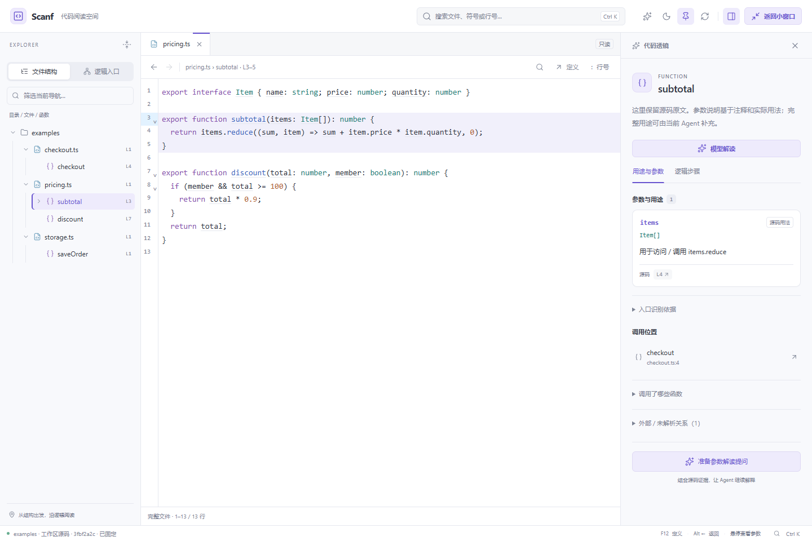

# Scanf — a code reading workspace

Explore mixed TypeScript / JavaScript, Python, C / C++, Java, Rust and Go projects through file and entry-point trees, full-source navigation, parameter evidence and optional AI hover explanations.



## Install

- **VS Code / Cursor:** [Download the VSIX](https://github.com/IweirdoI/scanf/releases/latest), select Extensions → … → Install from VSIX, then run **Scanf: 打开逻辑导航** with a supported-language workspace open. Not yet listed on extension marketplaces.
- **DeepSeek Harness:** Download the DSH `.tgz` from the same release, install via the local plugin entry, restart, and open Scanf in the right sidebar. Tested with Desktop 0.2.2-rc.5.
- **MCP agents:** Node.js 22+; prebuilt package, no compilation:

```sh
npm install -g https://github.com/IweirdoI/scanf/releases/download/v0.9.0/scanf-reader-0.9.0.tgz
scanf-reader setup --root "/absolute/path/to/project"
```

Copy the printed MCP configuration to your client. CLI: `scanf-reader --help`. Codex: `codex mcp add scanf -- scanf-reader mcp --root "/absolute/project/path"`.

## Features and limits

VS Code uses its native editor, file explorer, tabs, search and navigation. Scanf adds a branching node-and-edge graph in the built-in Explorer, cursor-follow / pin, function CodeLens, parameter hover and a prose-only explanation sidebar. Open **Scanf: 打开逻辑导航** in any supported workspace. Configure your API with **Scanf: 配置模型 API** using native inputs and SecretStorage.

DSH / MCP retain the shared reading workspace: file / entry-point trees, full read-only CodeMirror editor, definition jumps and parameter evidence. Optional OpenAI-compatible model settings and hover explanations are available in the DSH reader; DSH's separate native file preview is not extended.

Static analysis stays local. Enabling AI sends bounded source excerpts to your configured API provider. Keys use host credential storage. The MCP package uses the current agent for explanations and needs an MCP Apps host for graphical UI; plain tool results remain available otherwise. Codex native diff synchronization is not verified.

All languages share a single graph and indexing budget: 150 files, 256 KiB per file, 8 MiB total. TypeScript retains compiler-based resolution; the other languages share Tree-sitter syntax extraction. WASM parsers ship in the packages, without language toolchain prerequisites. Dynamic dispatch, build configuration and cross-language bridges are not guessed; mixed-language indexing does not imply cross-language call resolution. See [language support](docs/LANGUAGES.md).

GitHub Actions runs Windows / Linux CI; maintainers can dispatch the Release workflow to build and publish prebuilt packages. Mock API tests verify wiring, not real-model quality.

[中文](README.md) · [Installation / troubleshooting](docs/INSTALL.md) · [Contributing](CONTRIBUTING.md) · [MIT](LICENSE)
