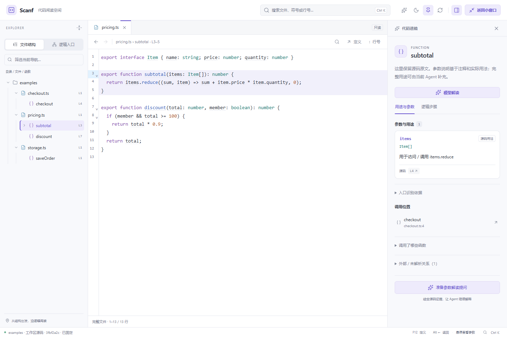
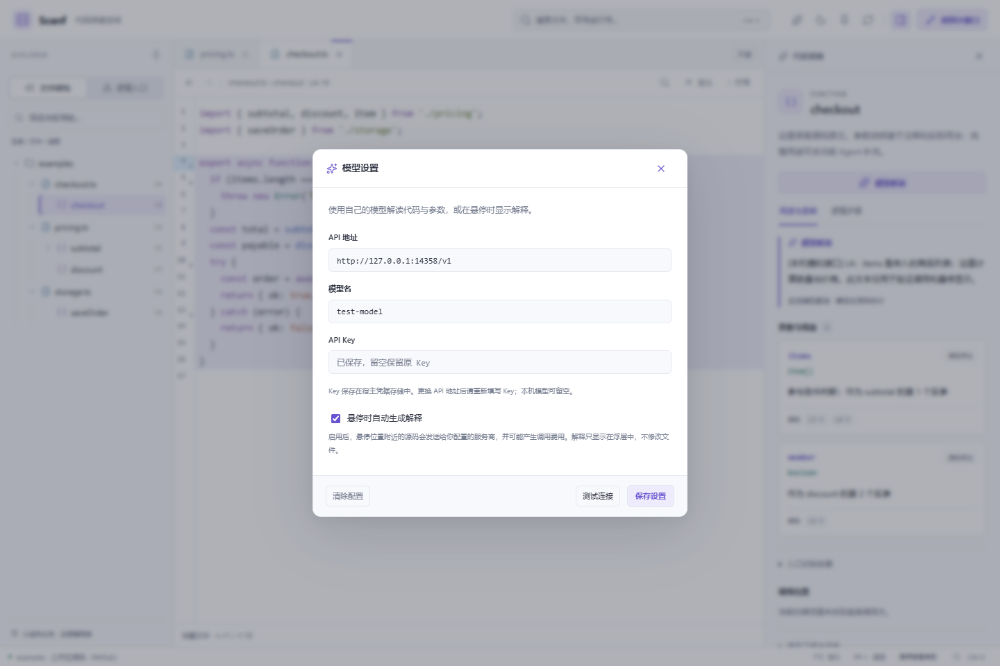

# Scanf · 代码阅读空间

**从项目结构出发，沿着函数调用读懂代码。** 多语言代码阅读插件，支持 VS Code / Cursor、DeepSeek Harness 和通用 MCP Agent。

[](https://github.com/IweirdoI/scanf/releases/latest)
[](LICENSE)

[下载安装](#installation) · [使用指南](docs/INSTALL.md) · [报告问题](https://github.com/IweirdoI/scanf/issues/new/choose) · [English](README.en.md)



- **两种树**：按文件目录找源码，或从逻辑入口沿调用关系阅读。
- **两种窗口**：小窗口看代码段，大工作台对照完整源码与用途、参数。
- **编辑器式导航**：定义跳转、文件标签及关闭、前进 / 返回、全文搜索、行号定位。
- **可选 AI 解读**：填写自己的 OpenAI 兼容 API，悬停查看解释，或解读整个函数。
- **源码证据**：参数类型、注释、实际使用位置；动态关系和未知用途明确标注。
- **混合语言项目**：TS / JS、Python、C / C++、Java、Rust、Go 共用文件树、入口树和源码导航；解析器随包安装，不需要各语言工具链。[支持范围](docs/LANGUAGES.md)

<a id="installation"></a>
## 安装：不需要编译源码

### VS Code / Cursor

1. [下载最新 VSIX](https://github.com/IweirdoI/scanf/releases/latest/download/scanf-code-reader-0.7.1.vsix)。
2. 编辑器扩展页 → `…` → **Install from VSIX / 从 VSIX 安装**，选择下载文件。
3. 打开项目（可以包含多种语言），命令面板运行 **Scanf: 打开代码阅读地图**。

也可以在下载目录执行：

```sh
code --install-extension scanf-code-reader-0.7.1.vsix
```

扩展已打包依赖，无需单独安装 Node.js。当前通过 GitHub Releases 分发，**尚未上架 VS Code Marketplace / Open VSX**。

### DeepSeek Harness

在 DSH 插件页选择本地安装，选取 [DSH 插件包](https://github.com/IweirdoI/scanf/releases/latest/download/dsh-scanf-reader-0.7.1.tgz)。或下载后执行：

```sh
dsh plugin --profile desktop add ./dsh-scanf-reader-0.7.1.tgz
```

重新启动 DSH，在项目会话右侧栏的新标签页中选择 **Scanf 代码阅读**。它自动读取当前会话目录；需要换目录时点“切换项目”。已实测 DSH Desktop **0.2.2-rc.5**，其他版本尚待验证。详见 [安装排错](docs/INSTALL.md#dsh)。

### 通用 MCP：Codex / Cursor / 其他 Agent

需要 **Node.js 22+**，不需要下载源码或运行 build：

```sh
npm install -g https://github.com/IweirdoI/scanf/releases/download/v0.7.1/scanf-reader-0.7.1.tgz
scanf-reader setup --root "/absolute/path/to/your-project"
```

将输出的 `mcpServers` 配置粘贴到客户端的 MCP 设置中。Codex CLI 可直接添加：

```sh
codex mcp add scanf -- scanf-reader mcp --root "/absolute/path/to/your-project"
```

先说：“用 Scanf 打开项目结构，找出入口，解释这个函数。”支持 MCP Apps 的宿主可显示阅读窗口；其他宿主仍能读取结构化工具结果。**Codex 原生 diff 自动联动尚未验收**。MCP 版目前由当前 Agent 提供解释；自填 API 和自动悬停在 VS Code / DSH 插件提供。

命令行预览：`scanf-reader preview --root "/your/project"`；帮助：`scanf-reader --help`。[完整配置说明](docs/INSTALL.md#mcp)

## 开始阅读

打开文件或函数 → 按需切到“逻辑入口” → 点调用节点或 `F12 / Ctrl+单击` 跳到定义 → 用 `Alt+←` 返回。

`Ctrl / Cmd+K` 搜索文件与符号，`Ctrl / Cmd+G` 跳到行。标签右侧 **×** 或鼠标中键关闭文件。明暗主题可切换，大窗导航栏可拖动调宽。

右上角 **星光按钮** 打开模型设置：填写 API 地址、模型名、Key → **测试连接**。勾选自动悬停后，在源码词语上停留即可显示解释。也可关掉自动调用，改为点击浮层中的解释按钮。



## 数据与边界

- 默认静态分析在本机执行，不执行被分析项目、不修改源码。基础阅读无需 API Key。
- 用户启用模型解释时，会向所配置服务商发送附近源码 / 当前函数的有限片段，可能产生调用费用。Key 由 VS Code SecretStorage 或 DSH credentials 保存，不写进项目或浏览器 localStorage。
- 支持 TS / JS、Python、C / C++、Java、Rust、Go 混合项目；默认最多 150 文件、每文件 256 KiB、总计 8 MiB，所有语言共享预算。大型仓库建议打开功能目录。
- 调用关系是静态分析结果，不是运行轨迹；反射、DI、多态或动态调用可能无法解析。
- VS Code 原生编辑器与 Scanf 阅读器支持悬停；DSH 支持 **Scanf 阅读面板**，不向 DSH 独立文件预览注入悬停。
- TS / JS 保留编译器语义分析；其他语言共享 Tree-sitter 语法分析。动态分派、构建条件、宏与跨语言 RPC / FFI 不推断为真实调用；混合项目索引不等于跨语言调用链已经解析。
- 核心测试覆盖混合项目、作用域、导入及离线安装包；界面测试覆盖完整源码、双树与跳转。AI 链路使用本机模拟 API 验证；不代表第三方模型质量或可用性已经验证。

## 开发与贡献

```sh
git clone https://github.com/IweirdoI/scanf.git
cd scanf
npm ci
npm run check
npm run build
npm test
npx playwright install chromium
npm run test:ui
```

Node.js 22+。UI 测试本地默认 Edge，CI 使用 Chromium。`.github/workflows` 提供 Windows / Linux CI 和手动触发的 Release，发布流程生成三个预构建安装包与校验文件。[贡献指南](CONTRIBUTING.md) · [发布流程](docs/RELEASING.md) · [更新记录](CHANGELOG.md) · [接入细节](docs/INTEGRATIONS.md)

## 致谢与许可

参考 [CodeTour](https://github.com/microsoft/codetour) 的源码导览、[Continue](https://github.com/continuedev/continue) 的侧栏体验与安装组织、[GitNexus](https://github.com/abhigyanpatwari/GitNexus) 的结构探索、[AST Explorer](https://github.com/fkling/astexplorer) 的源码 / 树联动。Scanf 为独立实现，未 fork 上述项目。

基于 TypeScript Compiler API、Tree-sitter、CodeMirror 6、MCP Apps、Lucide 等构建。[MIT](LICENSE)；第三方许可见 [THIRD_PARTY_NOTICES.txt](THIRD_PARTY_NOTICES.txt)。
